# MIRE MARE

*48K Sinclair ZX Spectrum, 1985 (2026)*

**Mire Mare** was the fourth Sabreman game, promised on the last screen of *Underwurlde* and never released by Ultimate Play the Game. This repository imagines that it was finished on schedule. It's a complete, original 48K ZX Spectrum game written from scratch in Z80 assembly as a **fan homage** in the style of 1984–85 Ultimate, together with a black "big box" release package: box, inlay, tape labels, advert and poster.

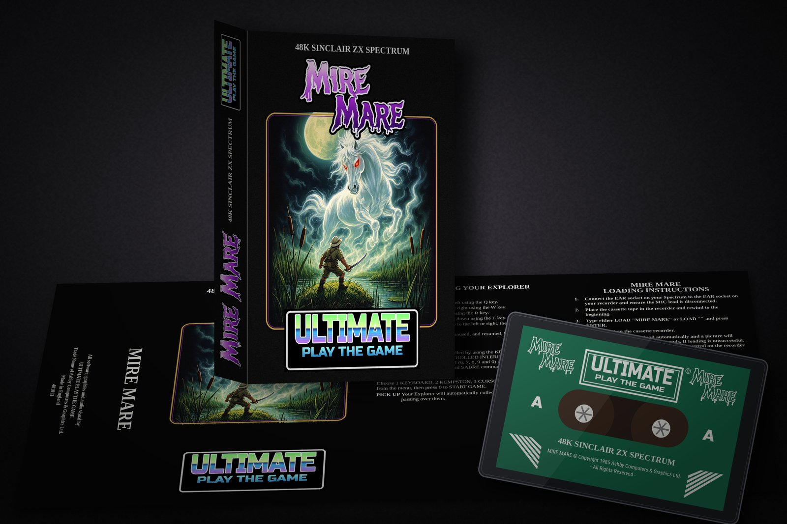

| | | |
|---|---|---|
| 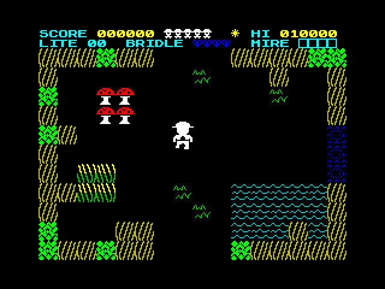 | 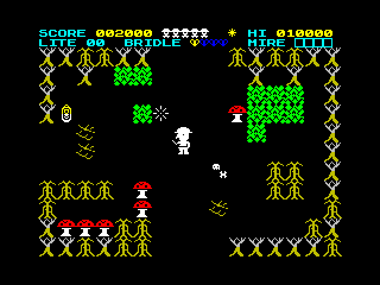 | 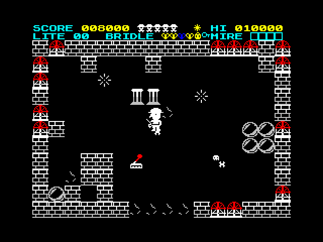 |
| 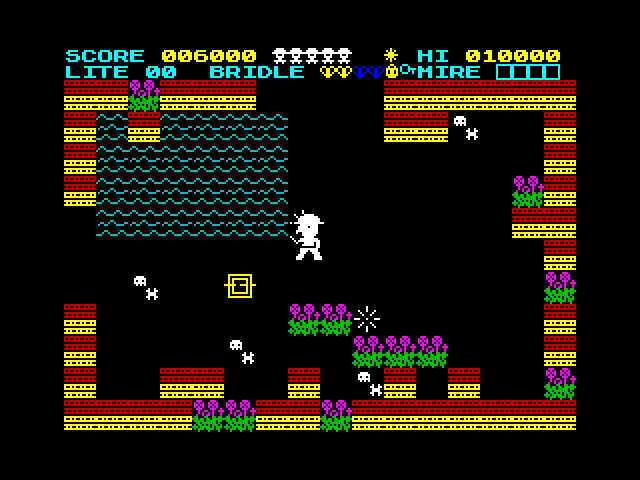 | 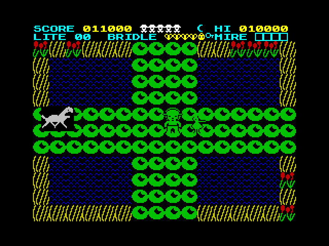 | 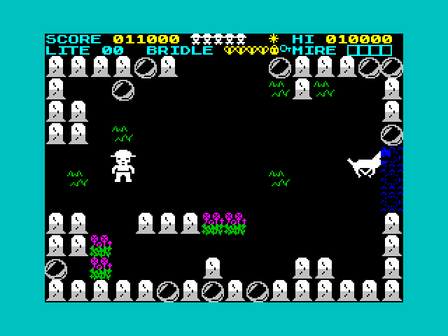 |

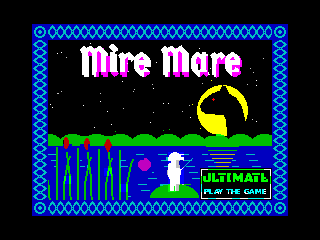

*The screenshots are from the Fuse emulator. The full 155-second run with sound is in [`media/fuse_demo.mp4`](media/fuse_demo.mp4).*

## The game

> *Sabreman sleeps no more. Since he won the Pentagram's power and drove the Lord of Underwurlde back below, something rides him through the night: hoof-beats in the dark, a weight upon the chest. Every night the dream ends at the drowned fen of MIRE MARE, where a grey mare with burning eyes waits on an island in the black Mere.*
>
> *A Night Mare can be ridden only if it is bridled.*

- **Goal:** find the four pieces of the Mare's Bridle (the **Bit**, the **Rein**, the **Headstall** and the **Buckle**). Then cross to Mare's Isle at night and strike the Mare with the sabre to bridle her.
- **World:** 160 flip screens on a 16 × 10 map, in the pure flip-screen style of *Sabre Wulf*, across five regions: **Sedge Fen**, **Gloaming Wood**, **Sunken Abbey**, **Peat Hags** and **The Mere** with Mare's Isle.
- **Day and night:** each day is 4 minutes of day and 2 minutes of night. At night the world dims, the bog rises, the creatures get worse, lily paths surface on the Mere and spirit doors open in the Abbey.
- **The Night Mare** roams the fen at night as an **unkillable hunter**. She moves one screen closer every few seconds, and her hoof-beats get faster as she nears. Her touch costs a life. A sabre stroke only drives her off, until you hold the whole bridle.
- **Also in the fen:** marsh-lights to collect, the lantern, key and lever, power-up buds, sinking bog, 9 kinds of creature, a percentage and rating screen, and a special ending for 100%.

### Controls

| Action | Keyboard | Kempston | Cursor | Interface II |
|---|---|---|---|---|
| Left | **Q** | left | 5 | 6 |
| Right | **W** | right | 8 | 7 |
| Up | **R** | up | 7 | 9 |
| Down | **E** | down | 6 | 8 |
| Sabre (strikes left/right) | **T** | fire | 0 | 0 |
| Pause | **ENTER** | – | ENTER | ENTER |

On the menu, press **1**–**4** to pick Keyboard, Kempston, Cursor or Interface II, and **0** to start.

## Playing it

The tape image is [`build/miremare.tap`](build/miremare.tap). It is also attached to the [latest release](../../releases/latest).

- **Fuse:** run `fuse build/miremare.tap` (or use *File → Open*). With auto-load on, the game loads by itself. Otherwise, type `LOAD ""` (J, then Symbol Shift+P twice) and press ENTER.
- **Any other Spectrum emulator** (ZEsarUX, Spectaculator, SpecEmu, Retro Virtual Machine, ZXSP, the browser-based Qaop/JSSpeccy, and so on): open the `.tap` as a tape, pick a **48K** machine, and `LOAD ""`.
- **Real hardware:** play the `.tap` into the EAR socket with a tape-audio converter such as `tape2wav` or PlayTZX, or load it from a divMMC or similar.

The game uses only the standard Sinclair ROM, which every emulator provides. If your emulator asks for a ROM file, you must supply your own. **No ROM image is included here.**

The two other tapes are test builds. `miremare_demo.tap` plays itself through a scripted god-mode run, and `miremare_sfx.tap` plays each beeper sound effect in turn. Recordings of the effects are in [`media/sfx/`](media/sfx).

## Building from source

Requirements:

- [pasmo](https://pasmo.speccy.org/) 0.5.3 (Z80 assembler)
- Python 3 with Pillow and NumPy
- a C compiler (`cc`/gcc), for the headless test emulator
- optionally, Fuse 1.6 with `xdotool`/X for the real-emulator scripts

```sh
export MIREMARE_ROM=/path/to/your/48.rom   # or copy it to roms/48.rom (git-ignored)
./build.sh            # art -> data -> pasmo -> build/miremare.tap, then the test suite
./build.sh notest     # build only (needs no ROM)
./build.sh sfx        # build/miremare_sfx.tap (sound-effect test)
python3 tools/bot.py && ./build.sh demo   # re-record the self-playing demo -> build/miremare_demo.tap
```

`./build.sh` compiles `tools/z80core.c`, a small headless Spectrum 48K core, into `tools/libz80core.so`. It then runs `tools/test_game.py`, which loads the game with scripted input to check movement, combat, the bog, day and night, the Mare, the items, the endings and the rating. `tools/progression.py` checks that all 160 rooms, every marsh-light and all 4 bridle pieces can be reached in order. The tests copy a 48K ROM into the emulated memory because the game builds its bold font from the ROM character set at start-up. That is why the tests need `MIREMARE_ROM`, and the plain build does not.

The packaging scripts in `packaging/src/` (run them from inside `packaging/`, for example `cd packaging && python3 src/front.py`) need the Google Fonts *Metal Mania*, *Russo One*, *Tinos* and *Roboto Condensed*, all under the SIL OFL. Install them and point the font folder `G` in `packaging/src/lib.py` at them. The fonts are not included here.

## Repository layout

| Path | Contents |
|---|---|
| `main.asm` | entry point; includes the engine and data |
| `engine/` | Z80 engine: game loop, player, rooms and room decompression, masked pre-shifted sprites, enemies, the Mare, items, HUD, menu, IM2 interrupt and 25 fps lock, beeper sound and tune player, demo/input playback |
| `data/` | generated tables (world, regions, tiles, sprites, UDGs, messages, tune) and the `loading.scr` SCREEN$ |
| `art/` | sprite, tile and UDG sources (text pixel art), plus the loading screen |
| `tools/` | Python build tools (graphics, world generator, tape writer), the C Z80 core, test suite, bot/walker/autopilot, Fuse automation and frame-alignment scripts |
| `attic/` | retired code from the vertical slice |
| `design.md` | full game design, with the as-built and balance notes |
| `PROGRESS.md` | development log |
| `build/` | the built tapes |
| `media/` | Fuse screenshots, gameplay GIF/MP4, sound-effect WAVs |
| `packaging/src/` | Pillow scripts that compose the packaging, and the cover paintings |
| `packaging/out/` | print-ready PDFs at 300 dpi with bleed: box front, back and spines, fold-out inlay (both sides), tape labels A/B, A4 advert and A3 poster. Also the Fuse loading screenshots |
| `packaging/preview/` | web-size JPEG previews of every packaging piece |

Full-resolution PNGs of the packaging and the combined 10-page `MIRE_MARE_packaging_all.pdf` are attached to the [release](../../releases/latest).

### Packaging previews

| Box front | Box back | Inlay (outer) |
|---|---|---|
| 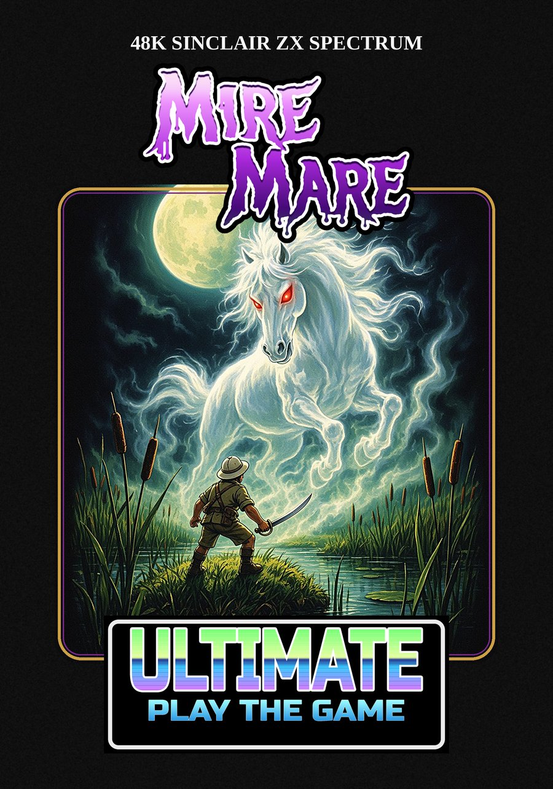 | 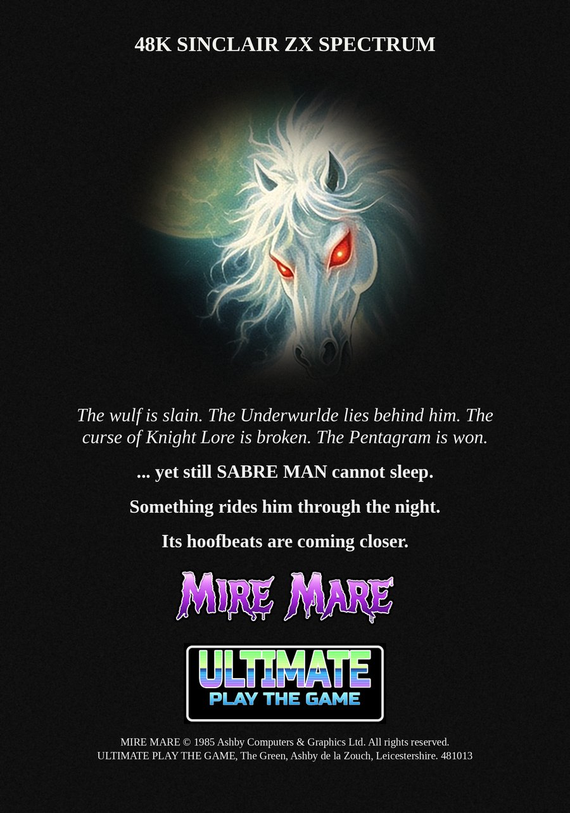 | 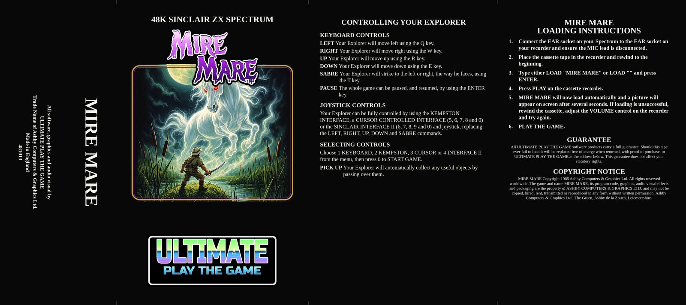 |

## Disclaimer

This is **unofficial, non-commercial fan work**. It is **not affiliated with, endorsed by or connected to** Ultimate Play the Game, Ashby Computers & Graphics, Rare Ltd. or Microsoft. *Ultimate Play the Game*, *Sabre Wulf*, *Sabreman*, *Underwurlde*, *Knight Lore* and the *Mire Mare* name are trademarks or property of their respective owners. The "1985 A.C.G." notice and the ULTIMATE badge in the game and on the packaging are period pastiche. They do not claim to be the work of, or carry the authority of, the rights holders.

**No original Ultimate code, graphics, sound, text or other assets are included.** Every byte of code, every sprite, the music, the cover paintings and all the packaging text were made new for this project. The Spectrum ROM, which is Amstrad's copyright, is **not** included either.

## License

- **Code** (assembly, Python, C, shell, and the built tapes): [MIT](LICENSE)
- **Artwork, audio, screenshots and text** (cover paintings, packaging, pixel art, loading screen, media, documentation): [CC BY-NC 4.0](https://creativecommons.org/licenses/by-nc/4.0/)

See [`LICENSE`](LICENSE) for details. Neither license grants rights to the third-party trademarks named above.
